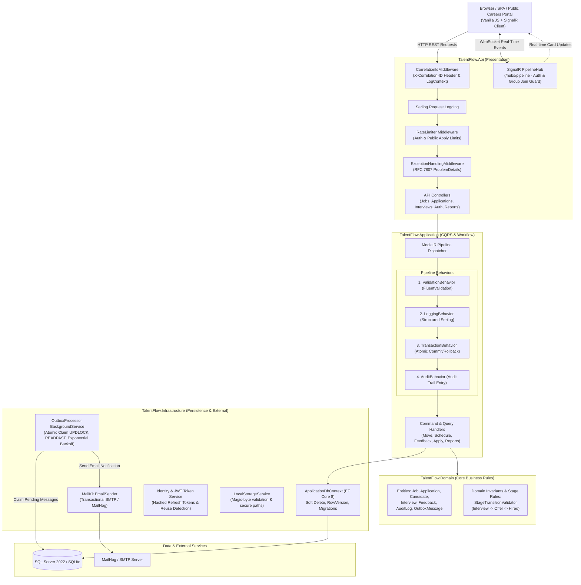

# TalentFlow: Applicant Tracking System (ATS) & Recruitment Pipeline

[](https://github.com/MeghrajGoudThigulla/TalentFlow/actions/workflows/ci.yml)
[](https://github.com/MeghrajGoudThigulla/TalentFlow/actions/workflows/deploy.yml)
[](https://dotnet.microsoft.com/)
[](LICENSE)
[](#-automated-testing--quality-gates)
[](#-automated-testing--quality-gates)

An enterprise-grade Applicant Tracking System (ATS) and recruitment workflow engine built with **C#**, **ASP.NET Core 8**, **Clean Architecture**, **CQRS via MediatR**, **EF Core**, **SignalR**, and **Docker**.

---

## 🌟 Key Architecture & Engineering Highlights

- **Clean Architecture with CQRS**: Decoupled domain entities and business rules with zero external dependencies. Command/Query segregation implemented via **MediatR** with a strictly ordered pipeline behavior chain:
  $$\text{Validation} \longrightarrow \text{Logging} \longrightarrow \text{Transaction} \longrightarrow \text{Audit}$$
- **Transactional Outbox Pattern**: Candidate email dispatches and workflow transitions occur within an atomic database transaction. An asynchronous background worker (`OutboxProcessor : BackgroundService`) guarantees at-least-once delivery with atomic claims (`UPDLOCK, READPAST`), exponential backoff, max retry limits, and deterministic `DedupeKey` idempotency.
- **Optimistic Concurrency Protection (`RowVersion`)**: Concurrency token tracking on pipeline applications prevents race conditions and lost updates when multiple recruiters review or move candidates simultaneously (`409 Conflict` resolution).
- **Real-Time Pipeline Synchronization (`SignalR`)**: Kanban board movements, candidate submissions, and interview updates broadcast in real-time over authenticated WebSocket groups (`job-{id}`) to keep all recruiter dashboards synced without manual page refreshes.
- **Resource-Based Authorization & IDOR Hardening**: Hiring managers are strictly restricted to reading and evaluating jobs and candidate applications specifically assigned to them.
- **Upload Hardening & Security**: Candidate resumes are inspected for extension allowlists, size caps (5 MB), and magic-byte signatures (`%PDF-`, `PK..`) before storage with randomized GUID paths outside the web root.
- **Structured Logging & Correlation**: Serilog with request correlation tracking (`X-Correlation-ID`) across HTTP headers, logs, and RFC 7807 ProblemDetails responses.

---

## 🏛 Architecture Diagram



---

## 🏗 Solution Layout (Clean Architecture)

```
TalentFlow/
├── src/
│   ├── TalentFlow.Domain/            # Pure entities, domain events, enums, business rule validators
│   ├── TalentFlow.Application/       # CQRS commands/queries, MediatR pipeline behaviors, DTOs, interfaces
│   ├── TalentFlow.Infrastructure/    # EF Core DbContext, Identity/JWT, SignalR hub, file storage, outbox worker
│   └── TalentFlow.Api/               # Controllers, RFC 7807 ProblemDetails middleware, Swagger, Static Kanban UI
├── tests/
│   ├── TalentFlow.Domain.Tests/      # Pure business rule & stage transition invariant unit tests
│   ├── TalentFlow.Application.Tests/ # CQRS command handler tests & concurrency conflict tests
│   ├── TalentFlow.ArchitectureTests/ # NetArchTest Clean Architecture dependency verification rules
│   └── TalentFlow.Api.IntegrationTests/ # WebApplicationFactory full-stack integration & security tests
├── docker-compose.yml                # Multi-container orchestration (API + SQL Server 2022 + MailHog)
├── Dockerfile                        # Multi-stage optimized production image
├── render.yaml                       # Render Infrastructure-as-Code Blueprint
├── .editorconfig                     # Solution-wide C# and code formatting standards
└── .github/workflows/
    ├── ci.yml                        # Automated CI: build, test, and 50% coverage gate
    └── deploy.yml                    # Automated Render deploy trigger & /health/ready smoke tests
```

---

## 🚀 Quick Start (Local Development)

### Prerequisites
- [.NET 8.0 SDK](https://dotnet.microsoft.com/download/dotnet/8.0)
- Optional: [Docker](https://www.docker.com/) & Docker Compose

### Option A: Run via .NET CLI (SQLite Default)
```bash
git clone https://github.com/MeghrajGoudThigulla/TalentFlow.git
cd TalentFlow

# Run the API and Dashboard
dotnet run --project src/TalentFlow.Api/TalentFlow.Api.csproj
```

The application will start at:
- **Interactive Kanban Dashboard & Careers Portal:** `http://localhost:5000`
- **Swagger API Documentation:** `http://localhost:5000/swagger`
- **Health Probes:** `http://localhost:5000/health/ready`

### Option B: Run Full Stack via Docker Compose (SQL Server + MailHog)
```bash
docker compose up --build
```

Services started:
- **TalentFlow API & Dashboard:** `http://localhost:5000`
- **MailHog Web UI (inspect outgoing emails):** `http://localhost:8025`
- **Microsoft SQL Server 2022:** `localhost:1433`

---

## 🔑 Pre-Seeded Demo Credentials

> [!NOTE]
> Demo accounts are automatically seeded **only in the Development environment** (`ASPNETCORE_ENVIRONMENT=Development`). Production deployments do not seed default accounts.

| Role | Email | Password | Permissions |
|---|---|---|---|
| **Admin** | `admin@talentflow.local` | `Admin@123456` | Full system access, audit logs, stage configuration, outbox retry |
| **Recruiter** | `recruiter@talentflow.local` | `Recruiter@123456` | Create/publish jobs, move pipeline cards, schedule/reschedule/cancel interviews |
| **Hiring Manager** | `hiringmanager@talentflow.local` | `Manager@123456` | Review assigned candidates, submit feedback, approve offers |

---

## ⚙️ Environment Variables & Configuration

Configure via `appsettings.json`, environment variables, or Docker/cloud provider settings:

| Variable | Description | Default | Example |
|---|---|---|---|
| `ASPNETCORE_ENVIRONMENT` | Hosting environment name | `Development` | `Production` |
| `PORT` | HTTP port to listen on (auto-detected on cloud hosts) | `5000` | `10000` |
| `UseSqlServer` | Toggle database provider (`true` = SQL Server, `false` = SQLite) | `false` | `true` |
| `ConnectionStrings__DefaultConnection` | Database connection string | `Data Source=talentflow.db` | `Server=sqlserver;Database=TalentFlowDb;User Id=sa;Password=...` |
| `JwtSettings__Secret` | Signing key for JWT validation (min 256 bits) | *Configured in appsettings.json* | `YourSuperSecretKeyWithAtLeast32BytesLength!` |
| `JwtSettings__Issuer` | Valid JWT Issuer | `TalentFlowApi` | `TalentFlowApi` |
| `JwtSettings__Audience` | Valid JWT Audience | `TalentFlowClient` | `TalentFlowClient` |
| `JwtSettings__ExpiryMinutes` | Access token lifespan (minutes) | `15` | `15` |
| `Cors__AllowedOrigins__0` | Origin allowlist for CORS | `http://localhost:5000` | `https://your-domain.com` |
| `EmailSettings__SmtpHost` | SMTP host for candidate email notifications | `localhost` (or empty for mock) | `mailhog` |
| `EmailSettings__SmtpPort` | SMTP port | `1025` | `1025` |
| `EmailSettings__FromEmail` | From email address | `noreply@talentflow.local` | `recruiting@company.com` |
| `EmailSettings__FromName` | Sender display name | `TalentFlow ATS` | `TalentFlow ATS` |
| `FileStorage__BasePath` | Disk path for uploaded resume files | `uploads/resumes` | `/app/uploads/resumes` |

---

## 🌐 Cloud Deployment (Render via Docker)

TalentFlow includes a native Render Blueprint (`render.yaml`) and an automated deployment pipeline (`.github/workflows/deploy.yml`).

### Deploying to Render Blueprint
1. In the [Render Dashboard](https://dashboard.render.com/), click **New +** > **Blueprint**.
2. Connect your GitHub repository.
3. Render reads `render.yaml` and provisions:
   - Web Service with runtime `docker` built from `Dockerfile`.
   - Persistent disk for SQLite storage and resume uploads.
   - Healthcheck path configured to `/health/ready`.

### Setting Up Automated GitHub Actions Deployment
Add these two secrets in your repository settings (**Settings** > **Secrets and variables** > **Actions**):
- `RENDER_DEPLOY_HOOK_URL`: The Deploy Hook URL from your Render service settings (**Settings** > **Deploy Hook**).
- `RENDER_SERVICE_URL`: The live URL of your Render service (e.g. `https://talentflow-api.onrender.com`).

Whenever changes merge to `main`, GitHub Actions:
1. Executes CI test suite and coverage threshold checks.
2. Triggers the Render deploy hook.
3. Awaits service launch and validates `/health/ready` and `/health/live` via automated smoke tests.

---

## 📡 Complete API Reference

All endpoints return RFC 7807 `ProblemDetails` on error and enforce role-based access control (RBAC).

### Authentication (`/api/auth`)
| Verb | Route | Auth / Role | Description |
|---|---|---|---|
| `POST` | `/api/auth/login` | Anonymous (Rate-limited) | Authenticates credentials; returns JWT + refresh token |
| `POST` | `/api/auth/refresh` | Anonymous | Rotates refresh token with reuse-detection detection |
| `POST` | `/api/auth/logout` | `[Authorize]` | Revokes refresh token |

### Public Careers Portal (`/api/public`)
| Verb | Route | Auth / Role | Description |
|---|---|---|---|
| `GET` | `/api/public/jobs` | Anonymous | Retrieves open public job postings with department filtering |
| `GET` | `/api/public/jobs/{id}` | Anonymous | Retrieves job posting details and requirements |
| `POST` | `/api/public/jobs/{id}/apply` | Anonymous (Rate-limited) | Submits candidate application with PDF/DOCX resume |

### Jobs Management (`/api/jobs`)
| Verb | Route | Auth / Role | Description |
|---|---|---|---|
| `GET` | `/api/jobs` | Admin, Recruiter, HM | Lists jobs (filtered by ownership for Hiring Managers) |
| `GET` | `/api/jobs/{id}` | Admin, Recruiter, HM | Retrieves job details (IDOR-protected for assigned HM) |
| `POST` | `/api/jobs` | Admin, Recruiter | Creates a new draft job |
| `PUT` | `/api/jobs/{id}` | Admin, Recruiter | Updates job posting details |
| `POST` | `/api/jobs/{id}/publish` | Admin, Recruiter | Publishes job to careers portal |
| `GET` | `/api/jobs/{id}/applications` | Admin, Recruiter, HM | Retrieves Kanban board applications grouped by stage |

### Candidate Applications (`/api/applications`)
| Verb | Route | Auth / Role | Description |
|---|---|---|---|
| `GET` | `/api/applications/{id}` | Admin, Recruiter, HM | Full candidate detail drawer (IDOR-protected) |
| `POST` | `/api/applications/{id}/move` | Admin, Recruiter | Moves candidate to new stage with optimistic concurrency checks |
| `POST` | `/api/applications/bulk-move` | Admin, Recruiter | Bulk transitions multiple candidates (e.g. bulk reject) |
| `POST` | `/api/applications/{id}/notes` | Admin, Recruiter, HM | Adds an internal evaluation note (IDOR-protected) |
| `GET` | `/api/applications/{id}/history` | Admin, Recruiter, HM | Retrieves stage transition audit history |
| `GET` | `/api/applications/{id}/resume` | Admin, Recruiter, HM | Streams resume file securely |
| `GET` | `/api/applications/{id}/offer-letter` | Admin, Recruiter, HM | Generates sanitized HTML offer letter preview |
| `POST` | `/api/applications/{id}/offer/approve` | Admin, Hiring Manager | Approves candidate offer package |

### Interviews (`/api/interviews`)
| Verb | Route | Auth / Role | Description |
|---|---|---|---|
| `POST` | `/api/applications/{id}/interviews` | Admin, Recruiter | Schedules an interview with calendar conflict checking |
| `PUT` | `/api/interviews/{id}` | Admin, Recruiter | Reschedules an existing interview |
| `DELETE` | `/api/interviews/{id}` | Admin, Recruiter | Cancels a scheduled interview |
| `POST` | `/api/interviews/{id}/feedback` | Admin, Recruiter, HM | Submits structured rating (1-5) and recommendation |

### Analytics & Reports (`/api/reports`)
| Verb | Route | Auth / Role | Description |
|---|---|---|---|
| `GET` | `/api/reports/time-to-hire` | Admin, Recruiter | Calculates average days from application to hire |
| `GET` | `/api/reports/stage-conversion` | Admin, Recruiter | Calculates pass-through and drop-off rates across stages |

### Health & Monitoring
| Verb | Route | Auth / Role | Description |
|---|---|---|---|
| `GET` | `/health/live` | Anonymous | Liveness probe (HTTP 200) |
| `GET` | `/health/ready` | Anonymous | Readiness probe verifying database connectivity |

---

## 🧪 Automated Testing & Quality Gates

The test suite enforces Clean Architecture boundaries, domain invariants, concurrency control, and security rules:

```bash
# Run all tests
dotnet test --verbosity normal

# Run with warnings treated as errors
dotnet build -warnaserror
```

| Test Project | Test Types & Coverage Focus | Tests |
|---|---|---|
| `TalentFlow.Domain.Tests` | Stage transition rules, Offer/Hire invariants, domain entity behavior | 12 |
| `TalentFlow.Application.Tests` | CQRS command handlers, bulk transitions, interview rescheduling, reporting | 42 |
| `TalentFlow.ArchitectureTests` | NetArchTest dependency checks: Domain zero deps, Application isolation | 5 |
| `TalentFlow.Api.IntegrationTests` | Auth, IDOR protection, CORS allowlist, rate limits, SignalR auth, concurrency | 31 |
| **Total** | **All 4 test suites pass cleanly** | **90 Passed** |

- **Code Coverage:** `TalentFlow.Application` achieves **73.4% line coverage**, exceeding the project threshold (enforced at ≥ 50% in CI).
- **Static Analysis:** Solution builds with zero warnings (`-warnaserror`).
- **Dependencies:** 0 vulnerable or abandoned packages.

---

## 📄 License

Licensed under the [MIT License](LICENSE).
